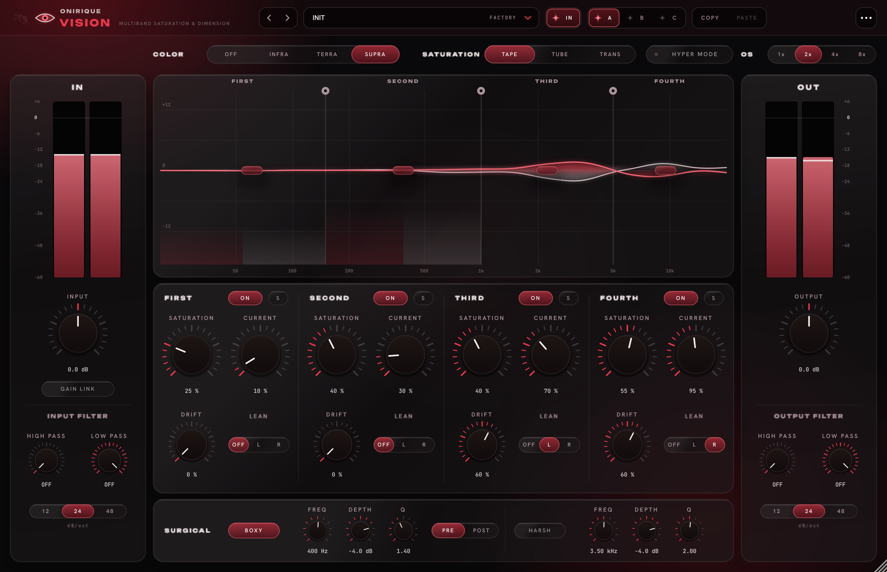

# ONIRIQUE VISION

Saturation multibande et dimension stéréo. Quatre bandes (FIRST, SECOND, THIRD, FOURTH), trois saturations (TAPE, TUBE,
TRANS), mouvement spectral CURRENT, décalage DRIFT, orientation LEAN, couleurs INFRA / TERRA / SUPRA, HYPER MODE,
filtres BOXY et HARSH, filtres d'entrée et de sortie, GAIN LINK, comparaison A / B / C. VST3 sur Windows, VST3 et
Audio Unit sur Mac.

Inspiré des fonctions de LACUNA (Sabol Hill) ; aucun code, algorithme propriétaire ni visuel n'en est repris :
chaque module est une implémentation originale, et l'interface suit la DA de VOCALBOX.



## Compiler

Prérequis : CMake 3.22 ou plus, Visual Studio 2022 (Windows) ou Xcode (Mac). JUCE 8.0.6 est téléchargé par CMake.

```
cmake -B build
cmake --build build --config Release
```

- `build/OniriqueVision_artefacts/Release/VST3/ONIRIQUE VISION.vst3` : le plugin.
- `build/VisionBench_artefacts/Release/VisionBench.exe` : le banc de mesure du moteur (séparation, filtres,
  saturations, CURRENT / DRIFT / LEAN, couleurs, clics, stabilité, processeur).
- `build/VisionPluginTest_artefacts/Release/VisionPluginTest.exe` : le test du plugin entier (état du projet, A / B / C,
  presets, paramètres, bus, BYPASS, latence).

Options CMake :

| Option | Défaut | Rôle |
|---|---|---|
| `VISION_LICENCE` | ON | la licence ONIRIQUE (OFF : build d'essai local, sans licence) |
| `VISION_TESTS` | ON | les deux bancs |
| `ONIRIQUE_UI_TEST` | OFF | build de captures (`ONIRIQUE_UI_TEST=nolicense,demo`, `ONIRIQUE_UI_PNG=fichier.png`) |

Pour réutiliser un JUCE déjà téléchargé : `-DFETCHCONTENT_SOURCE_DIR_JUCE=<dossier juce-src>`.

## Publication

À chaque envoi sur `main`, la CI (`.github/workflows/build.yml`) compile Windows et Mac, passe les deux bancs, puis
publie la version dans ONIRIQUE CENTRAL (slug `onirique-vision`) si le secret `ONIRIQUE_PUBLISH_KEY` est présent. Le
message du commit devient la note de version.

## Documentation technique

[Documentation/DSP.md](Documentation/DSP.md) : le chemin du son, chaque module, les mesures du banc.
